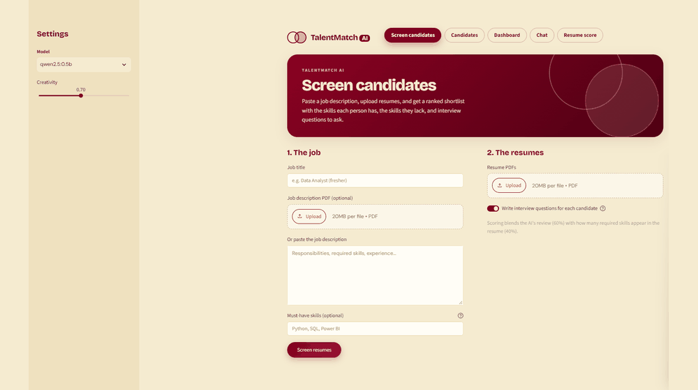

<p align="center">
  
</p>

<p align="center">
  <a href="https://github.com/vanamala-jayasurya"></a>
</p>

<p align="center">
  
  
  
  
  
</p>

**Screen resumes with a local AI model.** Paste a job description, upload resume PDFs, and get a ranked shortlist with the skills each candidate has, the skills they lack, and interview questions to ask. Everything runs on your own machine through [Ollama](https://ollama.com), so resumes never leave your infrastructure.

<p align="center">
  
</p>

## Features

- **Screen candidates**: add a job (title, pasted text or PDF, optional must-have skills), upload many resumes at once, and get them ranked by fit.
- **Hybrid scoring**: the final score blends the AI's review (60%) with the share of required skills found in the resume (40%), so one weak model answer can't sink or inflate a candidate.
- **Fit bands**: every candidate is labelled Strong, Good, Partial or Low fit.
- **Interview kits**: technical, behavioral and gap-probing questions per candidate, which can be regenerated and downloaded as Markdown.
- **Candidates board**: every screened candidate is saved per job. Filter by status (New, Shortlisted, Interviewing, Rejected), update status, delete, or export the ranking to CSV.
- **Dashboard**: pipeline charts across all jobs (status split, fit bands, score distribution, candidates per job, most common skill gaps).
- **Chat**: ask anything or upload a PDF and chat with it. Optional spoken replies with adjustable speed, plus chat export to CSV.
- **Resume score**: rule-based check of how complete and strong a resume is, with no job description needed, plus tips to improve it.
- **Accounts**: email and password sign-up (salted password hashes) and optional Google sign-in. Each user sees only their own jobs.
- **Structured output**: model replies are validated against Pydantic schemas, so small models still return usable JSON.

<h3>Screen candidates</h3>
<p>Add the job on the left and the resumes on the right, choose whether to generate interview questions, then press <b>Screen resumes</b>.</p>

<p align="center">
  
</p>

<p align="center">
  
</p>

<h3>Candidates</h3>
<p>Saved results grouped by job, with filters, status changes and CSV export.</p>

<p align="center">
  
</p>

<h3>Dashboard</h3>
<p>A quick look at the whole hiring pipeline across every job.</p>

<p align="center">
  
</p>

<h3>Chat</h3>
<p>Ask questions or chat with an uploaded PDF. Turn on <b>Speak replies</b> to hear answers read aloud.</p>

<p align="center">
  
</p>

<h3>Resume score</h3>
<p>Check how complete and strong a resume is without a job description.</p>

<p align="center">
  
</p>


| Layer | Tools |
| --- | --- |
| UI | Streamlit, Altair charts, custom CSS (wine and sand theme) |
| AI | Ollama (default `llama3.2:1b` in Docker Compose, `qwen2.5:0.5b` otherwise) |
| Data | SQLite (`users`, `jobs`, `candidates`) |
| Parsing and validation | pypdf, Pydantic, pandas |
| Packaging | Docker, Docker Compose |

## Quick start (Docker Compose)

```bash
docker compose up --build
```

Open <http://localhost:8501>. The first start downloads the model (about 1.3 GB for `llama3.2:1b`), so the first screening may wait a little.

Use a different model:

```bash
OLLAMA_MODEL=qwen2.5:3b docker compose up --build
```

Compose starts three services: `ollama` (the model server), `model-puller` (a one-off job that downloads the model) and `app` (Streamlit). Models and the database live in named volumes, so they survive restarts. For an NVIDIA GPU, uncomment the `deploy` block in `docker-compose.yml`.

## Run without Docker

```bash
python -m venv .venv
source .venv/bin/activate          # Windows: .venv\Scripts\activate
pip install -r requirements.txt

ollama serve &                     # in another terminal if you prefer
ollama pull llama3.2:1b

DB_PATH=./recruit.db OLLAMA_MODEL=llama3.2:1b streamlit run app.py
```

## Configuration

| Variable | Default | Purpose |
| --- | --- | --- |
| `OLLAMA_HOST` | `http://localhost:11434` | Where the Ollama server is |
| `OLLAMA_MODEL` | `qwen2.5:0.5b` (Compose sets `llama3.2:1b`) | Model selected by default |
| `OLLAMA_NUM_CTX` | `2048` | Context window sent to the model |
| `OLLAMA_KEEP_ALIVE` | `2m` | How long Ollama keeps the model loaded (single-container mode) |
| `DB_PATH` | `/data/recruit.db` | SQLite file; falls back to `./recruit.db` if `/data` isn't writable |
| `PORT` | `8501` | Port Streamlit listens on (Render sets this for you) |

### Google sign-in (optional)

Email sign-up works out of the box. To add Google sign-in, create `.streamlit/secrets.toml`:

```toml
[auth]
redirect_uri = "http://localhost:8501/oauth2callback"
cookie_secret = "a-long-random-string"

[auth.google]
client_id = "YOUR_CLIENT_ID"
client_secret = "YOUR_CLIENT_SECRET"
server_metadata_url = "https://accounts.google.com/.well-known/openid-configuration"
```

Never commit this file. It is listed in `.gitignore`.

## Deploy on Render

1. Push this folder to GitHub.
2. In Render choose **New → Web Service**, pick the repo, and set the runtime to **Docker**.
3. Use an instance with **2 GB RAM or more**. The free and 512 MB plans cannot run the model.
4. Add a **Disk** mounted at `/data` (5 GB or more). It stores the SQLite database and the downloaded model.
5. Optionally set `OLLAMA_MODEL`.
6. Deploy. Ollama runs inside the same container; `start.sh` launches it, pulls the model in the background, then starts Streamlit on `$PORT`. The app shows a notice until the model is ready.

`start.sh` also keeps memory use low (one model, one request at a time) and restarts Ollama automatically if it crashes.

## How scoring works

1. The model reads the job description and extracts the required skills (or uses your must-have list).
2. Each resume is read by the model, which returns a fit score from 0 to 100, strengths, concerns and core skills.
3. Required skills are also matched directly against the resume text, with aliases such as `js` for JavaScript and `k8s` for Kubernetes.
4. Final score = `0.6 × AI fit score + 0.4 × skill match score`.
5. Interview questions are generated per candidate unless you turn that off for faster runs.

The AI score is a screening aid, not a hiring decision. Always review shortlisted resumes yourself.

## Project structure

```
.
├── app.py                 # Streamlit app: UI, database, scoring, charts
├── start.sh               # Starts Ollama (if local) then Streamlit
├── Dockerfile             # App image with Ollama bundled (used on Render)
├── docker-compose.yml     # ollama + model-puller + app
├── requirements.txt
├── .streamlit/config.toml # Theme
├── demo.gif               # Animated walkthrough used in this README
└── Screenshot_*.png       # Screenshots used in this README
```

## Data

SQLite at `DB_PATH`, with the tables `users`, `jobs` and `candidates`. Duplicate resumes for the same job are detected by content hash and skipped.
